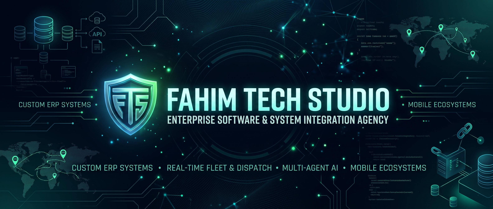

### Welcome to Fahim Tech Studio 👋
**Enterprise Software Engineering & System Integration Agency**

We architect robust enterprise solutions, high-performance offline-first mobile applications, and resilient cloud-to-edge network infrastructures.

###  Core Engineering Capabilities
- **Enterprise Solutions:** Custom ERP platforms, Point-of-Sale (POS) systems, and automated business workflows.
- **Mobile Architecture:** Cross-platform offline-first mobile applications with local SQLite persistence.
- **Backend Systems:** High-throughput microservices, RESTful APIs, and real-time event processing in Golang and PHP.
- **Infrastructure & Networking:** Advanced self-hosted server environments, MikroTik multi-WAN routing, and virtualization.

###  Technology Ecosystem
| Category | Stack & Tools |
| :--- | :--- |
| **Frontend & Web** | React, TypeScript, JavaScript, Tailwind CSS |
| **Mobile Engineering** | Flutter (iOS & Android) |
| **Backend & Services** | Golang, PHP / Laravel, REST APIs |
| **Databases** | PostgreSQL, SQLite |
| **DevOps & Infrastructure** | Linux, Docker, Proxmox VE, ESXi, MikroTik RouterOS, Cisco, Huawei |

###  Connect with Us
- **Website:** [fahimtechstudio.digital](https://www.fahimtechstudio.digital)
- **Email:** fahim_mushtaq1@msn.com
- **Location:** Pakistan
